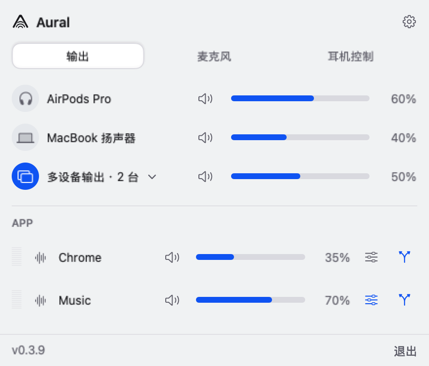
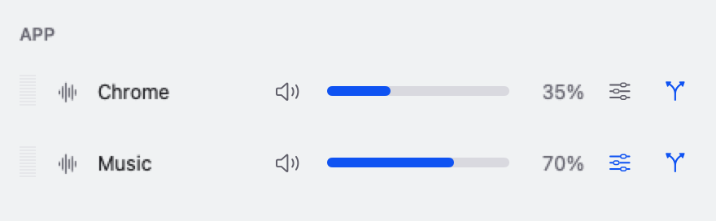
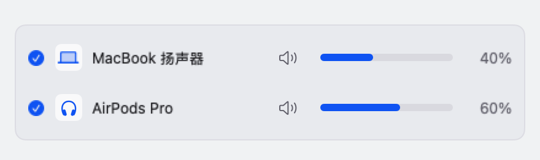
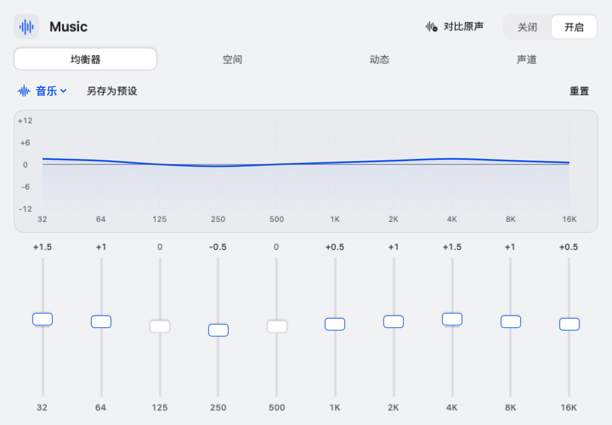

<p align="center">
  
</p>
<h1 align="center">Aural</h1>
<p align="center"><strong>Your Mac. Your Sound. Your Rules.</strong></p>
<p align="center">每个 App 的音量、输出路由与耳机控制，都在菜单栏。</p>
<p align="center"><a href="README.md">English</a> · <strong>简体中文</strong></p>
<p align="center">
  <a href="https://github.com/Colin0v0/Aural/releases/latest"></a>
  
  
  <a href="https://github.com/Colin0v0/Aural/actions/workflows/release.yml"></a>
  <a href="LICENSE"></a>
</p>
<p align="center">
  <a href="https://github.com/Colin0v0/Aural/releases/latest"><strong>下载 Apple Silicon 版本</strong></a> ·
  <a href="#兼容性与安装">安装前须知</a> ·
  <a href="docs/CHANGELOG.md">更新记录</a>
</p>
<p align="center">
  <a href="docs/images/hero-zh.png"></a>
</p>
<p align="center"><sub>界面预览由 Aural 0.3.9 使用示例设备和应用数据渲染，并非实时音频会话。<a href="docs/images/README.md">图片来源</a>。</sub></p>

> 免费、开源，无需账号。当前下载包使用 ad-hoc 签名，**尚未经过 Apple 公证**，macOS 可能阻止启动。[分发与权限说明](docs/TRUST_AND_TESTING.md#中文说明)。

## 为什么用 Aural？

**把浏览器调小，不必连音乐一起调小。** Aural 把各个 App 的音量和输出选择放进一个菜单栏面板，不用在播放器和系统声音设置之间来回找。

先用音量和静音就好。需要时，再到设置里开启多设备输出、应用音效或耳机控制；这三项默认关闭。

## 四个核心功能

<table>
<tr>
<td width="50%" valign="top">
<h3>每个 App，单独调节</h3>
<p>给 Chrome 和 Music 设置不同音量，单独静音；面板打开时可查看实时电平。</p>
<a href="docs/images/mixer-zh.png"></a>
</td>
<td width="50%" valign="top">
<h3>一个输出组，多种去向</h3>
<p>把扬声器和耳机加入同一组，保留各设备的独立控制，再为每个 App 选择组内输出。</p>
<a href="docs/images/outputs-zh.png"></a>
</td>
</tr>
<tr>
<td width="50%" valign="top">
<h3>按 App 调整听感</h3>
<p>十段 EQ、空间效果、音量均衡与声道控制。保存自己的预设，也能随时对比原声。</p>
<a href="docs/images/effects-zh.png"></a>
</td>
<td width="50%" valign="top">
<h3>耳机控制，抬手就到</h3>
<p>查看电量、切换当前型号公开的噪声模式。可用控制项取决于具体设备和固件。</p>
<a href="docs/images/headphones-zh.png"></a>
</td>
</tr>
</table>

## 怎么用：浏览器走扬声器，音乐走耳机

两台设备都在线时，可以这样配置：

<p align="center">
  
</p>

1. 在设置里开启 **显示多设备输出**。
2. 将扬声器和耳机加入输出组。
3. 在两个 App 中开始播放。分别打开它们的路由菜单，选择自定义输出：Chrome 选扬声器，Music 选耳机。

也可以选择 **全部输出**，让这个 App 跟随整个组。应用路由的选择范围是当前输出组，不是任意未连接设备。上图是配置示意，不是真机发声或延迟测试结果。

> **自定义路由不等于系统级隐私隔离。** 0.3.9 在所选目标全部不可用时，暂停该应用的 Aural 重放并保留静音捕获，不改用组内其他输出；播放器进度不会因此暂停。退出 Aural、撤销权限及全部真机切换场景不在此保证范围内。0.3.8 等旧版仍可能使用组内其他输出。[行为与限制](docs/TRUST_AND_TESTING.md#中文说明)。

## 兼容性与安装

| 安装前确认 | 当前范围 |
| --- | --- |
| Mac | Apple Silicon，**macOS 15.4 或更新版本**。目前不提供 Intel 发布包。 |
| 耳机 | 已实现部分 **Apple / Beats、Bowers & Wilkins、Sony、OPPO、Bose、Sennheiser** 型号的控制；不代表这些品牌全系兼容。 |
| 验证状态 | 许多型号仍标为 **上游已验证** 或 **实验性**，不能等同于 Aural 独立真机验收。详见[逐型号兼容表](docs/HEADPHONE_COMPATIBILITY.md)。 |
| 权限 | 系统音频录制权限用于应用音频处理，蓝牙权限用于耳机控制；麦克风页只调节硬件设置，不录制麦克风。 |

### 安装

1. 从 [GitHub Releases](https://github.com/Colin0v0/Aural/releases/latest) 下载 arm64 DMG。
2. 打开安装包，将 Aural 拖入 **应用程序**。替换前先退出仍在运行的旧版本。
3. 启动后按系统提示授权。当前启动流程需要系统音频录制权限才能进入主界面。
4. 在任意 App 中播放音频，再点击菜单栏的 Aural；可选功能在设置中开启。

发布页提供 SHA-256 校验文件。当前包为 ad-hoc 签名，尚无 Developer ID 签名及 Apple 公证。请遵循 macOS 的安全提示，项目不要求关闭 Gatekeeper 或 SIP。

### 使用前请了解

- 切换输出可能短暂断音。不同蓝牙设备的延迟可能不同，多设备输出不保证各设备严格同步。
- 休眠、断连或处理失败后，部分应用可能需要 **重新应用**。在公共场合使用前，请先把设备音量调低，验证自己的重连流程。
- 应用处理不支持部分受保护音频、第三方聚合设备及部分双工、多流音频接口；当前 PCM 路径支持原生 Float32 单声道或双声道。
- 自动测试覆盖状态变化与合成音频，**不代表所有真机组合、长时间播放或漏音场景均已验收**。[测试范围与真机清单](docs/TRUST_AND_TESTING.md#中文说明)。

## 技术细节

### 音频留在本机，诊断由你分享

Aural 在本机处理音频，不保存录音、不上传音频，无需账号，也不收集遥测。应用会访问 GitHub 检查更新和下载新版本。

遇到问题时，可在 **设置 → 诊断 → 导出诊断报告…** 保存 JSON。报告在主动分享前只保留在本机，包含当前音频状态与近期内存事件，不含音频样本。设备名称、UID、蓝牙地址及应用身份可能出现在其中，公开前请先检查并移除私人信息。

### 构建与检查

需要 Swift 6 工具链和 macOS 15.4 或更新版本：

```sh
git clone https://github.com/Colin0v0/Aural.git
cd Aural
./Scripts/check.sh
open dist/Aural.app
```

`check.sh` 会运行测试、构建应用、验证本地签名，并在宿主 Mac 上读取输出和输入设备诊断。无需真实音频硬件的发布检查由 [GitHub Actions](https://github.com/Colin0v0/Aural/actions/workflows/release.yml) 执行。绿色 CI 表示这些检查通过，不代表 Apple 认证或全部硬件验收完成。

| 详细文档 | 内容 |
| --- | --- |
| [稳定性、限制与测试](docs/TRUST_AND_TESTING.md#中文说明) | 已知风险、验证边界与问题反馈方式 |
| [耳机兼容性](docs/HEADPHONE_COMPATIBILITY.md) | 具体型号、协议证据及实验性支持 |
| [开发与诊断](docs/DEVELOPMENT.md) | 源码结构、命令与本地构建 |
| [音频权限实现](docs/audio-capture-permission.md) | 权限处理与非公开接口依赖 |
| [发布清单](docs/RELEASING.md) · [更新日志](docs/CHANGELOG.md) | 打包要求与各版本修复记录 |
| [第三方声明](THIRD_PARTY_NOTICES.md) · [MIT 许可证](LICENSE) | 代码来源与许可条款 |

发现问题，可以[提交 Issue](https://github.com/Colin0v0/Aural/issues/new?template=bug_report.yml)，附上版本、确切设备型号和复现步骤。上传诊断前先移除私人信息。以上界面预览的生成方式见[图片来源](docs/images/README.md)。
